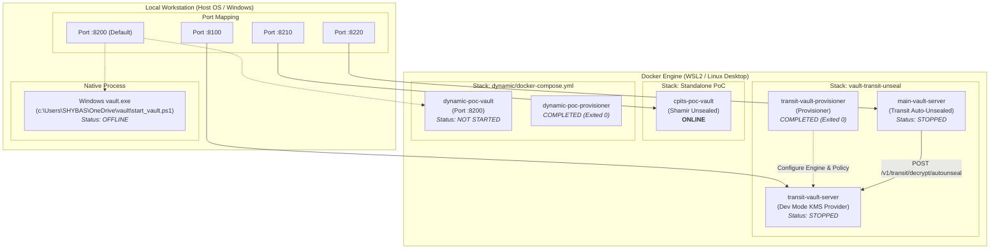

# HashiCorp Vault Servers & Environment Inventory

> [!NOTE]
> **Environment Summary:** This document catalogues all active, configured, and provisioning HashiCorp Vault servers across your local workstation and Docker containers. It covers network port allocations, unseal mechanisms, cluster identifiers, and operational commands.

---

## 1. High-Level Architecture Topology



---

## 2. Active Running Vault Servers (Live Verified)

| Container Name | Host Port | Internal Port | Unseal Mechanism | Storage Backend | Version | Status & Cluster ID |
| :--- | :--- | :--- | :--- | :--- | :--- | :--- |
| **`transit-vault-server`** | `8100` | `8200` | In-Memory (Dev Mode) | In-Memory | `v1.16.0` | **STOPPED** (Configured)<br>`cluster_id: 061b8df1-302d-4e18-127b-c99e025b2dc4` |
| **`cpits-poc-vault`** | `8210` | `8200` | Shamir Secret Sharing | Container Storage | `v1.16.0` | **STOPPED** (Configured)<br>`cluster_id: 2df4c8c7-51be-3c55-dcff-2ecc47dd05b8` |
| **`main-vault-server`** | `8220` | `8200` | **Transit Auto-Unseal**<br>(via `transit-vault-server:8200`) | File (`/vault/data`) | `v1.16.0` | **STOPPED** (Configured)<br>`cluster_id: 33978874-01b4-e622-e41d-478461bf80f1` |

### API Endpoints & Access Tokens

1. **Transit KMS Vault (`transit-vault-server`)**
   - **Web UI & API:** [http://127.0.0.1:8100](http://127.0.0.1:8100)
   - **Root Token:** `transit-root-token`
   - **Key Name:** `transit/keys/autounseal`
   - **Service Policy:** `autounseal`

2. **Auto-Unsealed Main Vault (`main-vault-server`)**
   - **Web UI & API:** [http://127.0.0.1:8220](http://127.0.0.1:8220)
   - **Root Token:** Stored in [`vault-transit-unseal/target_vault_keys.json`](file:///c:/Users/SHYBAS/OneDrive/AIP-C01-main/vault-transit-unseal/target_vault_keys.json)
   - **Unseal Behavior:** Auto-decrypts on startup with zero human intervention. Uses **Recovery Keys** instead of Shamir unseal keys.

3. **CPITS PoC Vault (`cpits-poc-vault`)**
   - **Web UI & API:** [http://127.0.0.1:8210](http://127.0.0.1:8210)
   - **Purpose:** Standalone testbed container for CPITS proof-of-concept.

---

## 3. Configured / Offline Vault Servers

| Server / Environment | Location / Definition | Port | Current Status | Notes |
| :--- | :--- | :--- | :--- | :--- |
| **`dynamic-poc-vault`** | [`dynamic/docker-compose.yml`](file:///c:/Users/SHYBAS/OneDrive/AIP-C01-main/dynamic/docker-compose.yml#L27-L48) | `8200:8200` | **Stopped / Not Created** | Part of the Ecommerce dynamic database credentials lab. Its dependencies (`dynamic-poc-postgres` and `dynamic-poc-payment-app`) are currently running. |
| **Windows Native `vault.exe`** | `c:\Users\SHYBAS\OneDrive\vault\start_vault.ps1` | `127.0.0.1:8200` | **Stopped** | Local Windows dev server run via PowerShell. Uses root token `root`. |

---

## 4. Completed Helper / Provisioner Containers

These containers ran one-time initialization tasks and exited with code `0`:

| Container Name | Stack | Exit Code | Responsibility |
| :--- | :--- | :--- | :--- |
| **`vault-transit-init`** | [`vault-transit-unseal`](file:///c:/Users/SHYBAS/OneDrive/AIP-C01-main/vault-transit-unseal/docker-compose.yml) | `Exited (0)` | Enabled the `transit` secrets engine on `vault-transit-kms`, created the `autounseal` key, written policy `autounseal`, and minted `transit-autounseal-token`. |
| **`dynamic-poc-provisioner`** | [`dynamic`](file:///c:/Users/SHYBAS/OneDrive/AIP-C01-main/dynamic/docker-compose.yml) | `Exited (0)` | Configured dynamic PostgreSQL database roles and policies for the Payment Gateway service. |

---

## 5. Port Allocation Reference Matrix

To prevent port collision on the host machine, ports are partitioned as follows:

| Port | Service | Bound To | Conflict Avoidance Strategy |
| :--- | :--- | :--- | :--- |
| **`8100`** | Transit KMS Server | Docker `transit-vault-server` | Dedicated for the Auto-Unseal KMS provider. |
| **`8200`** | Default Vault Port | Windows `vault.exe` / `dynamic-poc-vault` | Standard default Vault port. Only one can bind at a time. |
| **`8210`** | Standalone PoC Server | Docker `cpits-poc-vault` | Shifted to `:8210` to avoid conflict with standard `:8200`. |
| **`8220`** | Auto-Unsealed Vault | Docker `main-vault-server` | Shifted to `:8220` for clean multi-instance testing. |

---

## 6. Quick Management Commands

### Check Health of All Vault Endpoints
```powershell
8100, 8210, 8220 | ForEach-Object {
    $url = "http://127.0.0.1:$_/v1/sys/health"
    $h = Invoke-RestMethod -Uri $url -Method Get
    [PSCustomObject]@{
        Port    = $_
        Cluster = $h.cluster_name
        Sealed  = $h.sealed
        Version = $h.version
    }
} | Format-Table -AutoSize
```

### Start / Stop the Transit Auto-Unseal Stack
```powershell
# Navigate to transit lab folder
cd c:\Users\SHYBAS\OneDrive\AIP-C01-main\vault-transit-unseal

# Start stack
docker compose up -d

# Run auto-unseal verification test
python test_autounseal.py

# Stop stack
docker compose down
```

### Start the CPITS PoC Vault
```powershell
docker start cpits-poc-vault
```
