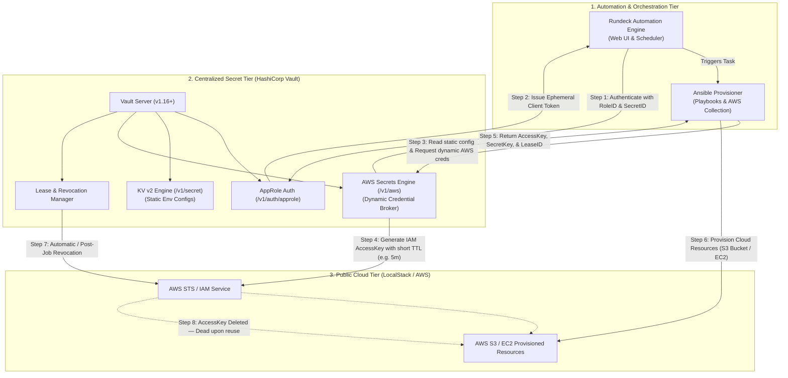
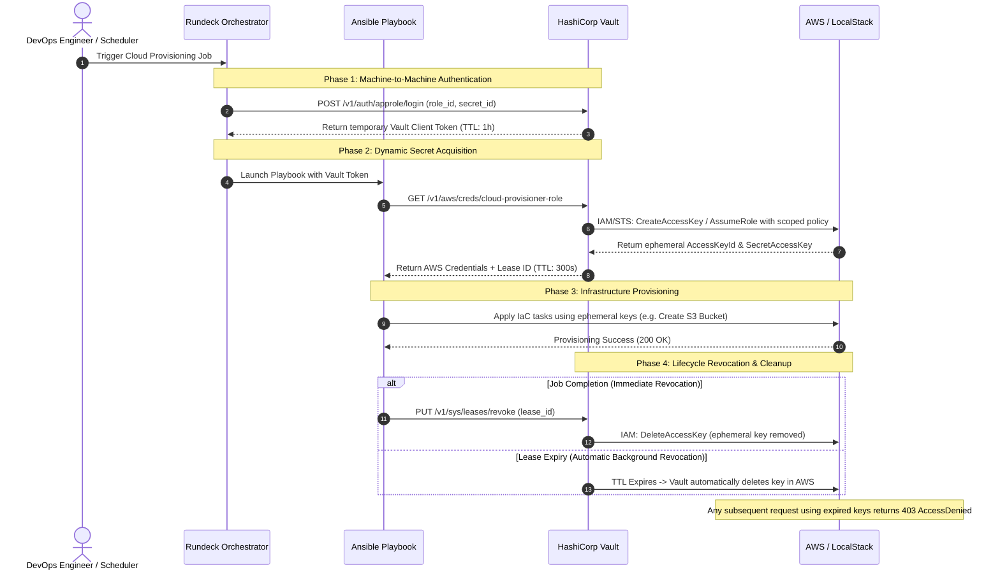

# Implementation Plan: Universal Centralized Secret Data Management for Automated Public Cloud Provisioning
## Proof of Concept (PoC) Specification based on Martseniuk et al. (CPITS-II 2024)

> [!NOTE]
> **Source Paper Reference:**
> Martseniuk, Y., Partyka, A., Harasymchuk, O., & Shevchenko, S. (2024). *Universal centralized secret data management for automated public cloud provisioning*. In *Cybersecurity Providing in Information and Telecommunication Systems II (CPITS-II 2024)*, CEUR Workshop Proceedings, Vol-3826, pp. 72–81. ISSN 1613-0073.
> Local Copy: [Y_Martseniuk_A_Partyka_O_Harasymchuk_S_Shevchenkor_CPITS_2024_3826.pdf](file:///c:/Users/SHYBAS/OneDrive/AIP-C01-main/dynamic/Dynamic/Y_Martseniuk_A_Partyka_O_Harasymchuk_S_Shevchenkor_CPITS_2024_3826.pdf)

---

## 1. Executive Summary & Objective

This implementation plan provides the complete technical design, architectural specification, and deployment roadmap for building a **reproducible, zero-cost, and enterprise-grade Proof of Concept (PoC)** strictly adhering to the methodology published in the CPITS-II 2024 paper.

The objective of this PoC is to demonstrate how **HashiCorp Vault** serves as an intermediary identity-driven secret broker that replaces static cloud credentials with **short-lived dynamic credentials** during automated infrastructure provisioning managed by **Rundeck** and **Ansible**.

### Core Tenets of the PoC
1. **Zero Static Credentials in CI/CD:** Neither Rundeck, Ansible, nor source repositories store persistent AWS access keys or secrets.
2. **Machine-to-Machine Identity:** Orchestrators authenticate to Vault using the **AppRole** method (`RoleID` + `SecretID`).
3. **Ephemeral AWS IAM Credentials:** Vault's **AWS Secrets Engine** generates temporary IAM/STS keys with a defined Time-To-Live (TTL) and least-privilege IAM policies.
4. **Automated Provisioning:** Ansible consumes the dynamically issued AWS credentials to provision cloud infrastructure (e.g., S3 buckets, EC2 compute instances).
5. **Guaranteed Revocation:** Upon job completion or TTL expiry, Vault automatically revokes the credentials in AWS, rendering any intercepted keys immediately invalid (`AccessDenied`).
6. **100% Self-Contained & Free:** Implemented using **LocalStack** to emulate AWS IAM/STS/S3/EC2 locally without requiring a paid AWS account or risking cloud billing. It can also effortlessly target a live AWS account via configuration switch.

---

## 2. Architecture & High-Level Design (HLD)

### 2.1. End-to-End Component Flow



### 2.2. Sequence Diagram: Dynamic Provisioning Lifecycle



---

## 3. Directory Structure (Under `dynamic/Dynamic/`)

All files for this PoC will reside exclusively within the [`Dynamic/`](file:///c:/Users/SHYBAS/OneDrive/AIP-C01-main/dynamic/Dynamic) directory:

```text
dynamic/Dynamic/
├── IMPLEMENTATION_PLAN.md                     # This comprehensive specification
├── Y_Martseniuk_A_Partyka_O_..._3826.pdf     # Reference Research Paper
├── docker-compose.yml                         # Vault + LocalStack + Rundeck infrastructure
├── README.md                                  # Complete user & developer guide for the PoC
├── run_poc.py                                 # Automated Python end-to-end demo runner
├── config/
│   ├── vault-config.hcl                       # Vault server configuration
│   └── rundeck.properties                     # Rundeck configuration
├── vault/
│   ├── policies/
│   │   └── rundeck-provisioner.hcl            # Least-privilege ACL policy for Rundeck
│   └── scripts/
│       ├── setup_vault.py                     # Python automator to mount AppRole, KV v2, & AWS engine
│       └── setup_vault.sh                     # Bash equivalent for container startup
├── ansible/
│   ├── ansible.cfg                            # Ansible configuration
│   ├── inventory.ini                          # Target hosts inventory
│   ├── requirements.yml                       # Required collections (amazon.aws, community.general)
│   ├── provision_cloud.yml                    # Main cloud provisioning playbook
│   └── test_revocation.yml                    # Playbook to verify access is denied post-revocation
└── rundeck/
    └── jobs/
        └── cloud-provisioning-job.yaml        # Exportable Rundeck job definition integrating Vault
```

---

## 4. Detailed Component Specifications

### 4.1. Centralized Secret Tier: HashiCorp Vault
* **Version:** HashiCorp Vault 1.16+
* **Storage Backend:** In-memory or file storage for local PoC.
* **Auth Method (`/v1/auth/approle`):**
  * Role Name: `rundeck-provisioner`
  * Bindings: `token_ttl=1h`, `token_max_ttl=4h`, `secret_id_ttl=0` (or rotatable).
* **Policy (`rundeck-provisioner.hcl`):**
  ```hcl
  # Read versioned static config from KV v2
  path "secret/data/cloud/config" {
    capabilities = ["read"]
  }

  # Generate ephemeral AWS credentials
  path "aws/creds/cloud-provisioner-role" {
    capabilities = ["read"]
  }

  # Allow explicit lease revocation upon job completion
  path "sys/leases/revoke" {
    capabilities = ["update"]
  }
  ```
* **AWS Dynamic Secrets Engine (`/v1/aws`):**
  * Root Configuration: Points to AWS STS / LocalStack endpoint (`http://localstack:4566`).
  * Role Name: `cloud-provisioner-role`
  * Credential Type: `iam_user` (or `assumed_role`).
  * Default Lease TTL: `300s` (5 minutes).
  * Max Lease TTL: `900s` (15 minutes).
  * Policy Document: Scoped strictly to S3 and EC2 actions (adhering to Least Privilege).

### 4.2. Cloud Target Tier: LocalStack (AWS Emulation)
* **Services Emulated:** `iam`, `sts`, `s3`, `ec2`.
* **Port:** `4566`.
* **Zero Cost & Offline:** Operates entirely within Docker without needing AWS credentials, avoiding any risk of accidental cloud bills.
* **AWS Parity:** Vault communicates with LocalStack using standard AWS SDK protocols.

### 4.3. Task Orchestration Tier: Rundeck
* **Role:** Centralized task executor triggered by schedule or DevOps engineers.
* **Vault Integration:**
  * Rundeck holds only the `RoleID` and `SecretID`.
  * A pre-execution workflow step executes Vault AppRole login to fetch the dynamic client token.
  * Rundeck passes the client token to the Ansible provisioning runner.
  * In the post-execution step (or finally block), Rundeck triggers lease revocation to guarantee zero lingering access keys.

### 4.4. Provisioning Engine: Ansible Playbooks
* **Collection:** `amazon.aws` (or `community.aws`).
* **Workflow:**
  1. Calls Vault API (via Ansible URI module or Python task) to obtain dynamic AWS keys for role `cloud-provisioner-role`.
  2. Sets temporary environment variables: `AWS_ACCESS_KEY_ID`, `AWS_SECRET_ACCESS_KEY`, `AWS_SESSION_TOKEN`.
  3. Provisions resources:
     - Creates S3 Bucket: `dynamic-provisioned-bucket-<timestamp>`
     - Tags resources with job ID, author, and lease ID for complete auditability.
  4. Returns output state and lease ID.

---

## 5. Phased Implementation Roadmap

| Phase | Milestone | Deliverables | Verification Criteria |
| :--- | :--- | :--- | :--- |
| **Phase 1** | **Container Infrastructure** | `docker-compose.yml`, network bridges, storage volumes | All services (`vault`, `localstack`, `rundeck`) health checks pass. |
| **Phase 2** | **Vault Configuration & Security Policies** | `setup_vault.py`, `rundeck-provisioner.hcl`, AppRole setup | AppRole login generates token; AWS engine connected to LocalStack. |
| **Phase 3** | **Ansible Provisioning Playbooks** | `provision_cloud.yml`, `requirements.yml`, `test_revocation.yml` | Playbook acquires dynamic credentials and creates an S3 bucket in LocalStack. |
| **Phase 4** | **Rundeck Job Automation** | `cloud-provisioning-job.yaml` | Rundeck imports job, executes pipeline successfully via UI / CLI. |
| **Phase 5** | **Automated Demo Runner & Validation** | `run_poc.py`, `README.md` | Single-command end-to-end execution demonstrating credential issuance, provisioning, and post-revocation failure. |

---

## 6. Test & Verification Plan

The implementation will be verified through 4 specific test scenarios orchestrated by `run_poc.py`:

```
┌────────────────────────────────────────────────────────────────────────┐
│                        PoC Test Execution Matrix                       │
├────┬─────────────────────────────┬───────────────────┬────────────────┤
│ #  │ Test Scenario               │ Expected Behavior │ Status Check   │
├────┼─────────────────────────────┼───────────────────┼────────────────┤
│ T1 │ AppRole Machine Auth        │ RoleID/SecretID   │ 200 OK + Token │
│    │                             │ yields token      │                │
├────┼─────────────────────────────┼───────────────────┼────────────────┤
│ T2 │ Dynamic AWS Credential Gen  │ Ephemeral keys    │ Key generated  │
│    │                             │ created with TTL  │ Lease active   │
├────┼─────────────────────────────┼───────────────────┼────────────────┤
│ T3 │ Cloud Resource Provisioning │ Ansible creates   │ Bucket/EC2     │
│    │ using Dynamic Keys          │ S3 resource       │ Created (200)  │
├────┼─────────────────────────────┼───────────────────┼────────────────┤
│ T4 │ Post-Lease Revocation &     │ Vault drops key;  │ 403 Forbidden  │
│    │ Zero-Trust Access Failure   │ reuse fails       │ (AccessDenied) │
└────┴─────────────────────────────┴───────────────────┴────────────────┘
```

---

## 7. Immediate Next Steps

1. **Review & Sign-Off:** Confirm that this implementation plan matches all requirements and constraints.
2. **Phase 1 Execution:** Build the `docker-compose.yml` and container scaffolding directly in [`dynamic/Dynamic/`](file:///c:/Users/SHYBAS/OneDrive/AIP-C01-main/dynamic/Dynamic).
3. **Phase 2–5 Execution:** Implement configuration automators, Ansible playbooks, Rundeck job templates, and `run_poc.py`.
