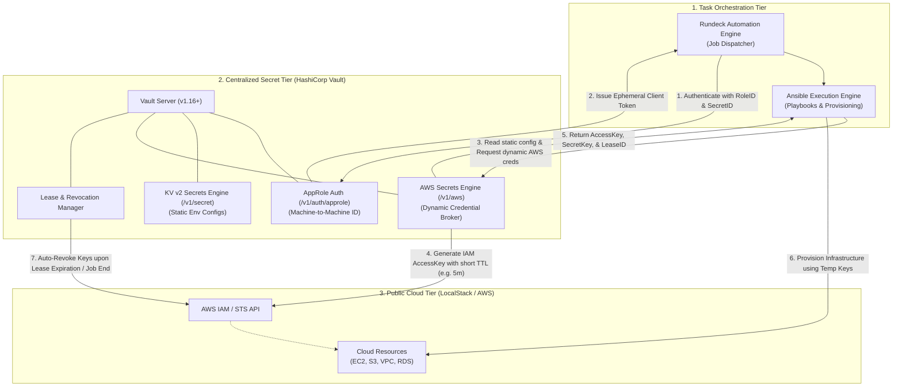

# Universal Centralized Secret Data Management for Automated Public Cloud Provisioning
## Proof of Concept (PoC) & Implementation Reference (CPITS-II 2024)

> [!NOTE]
> **Source Paper Reference:**  
> Martseniuk, Y., Partyka, A., Harasymchuk, O., & Shevchenko, S. (2024). *Universal centralized secret data management for automated public cloud provisioning*. In *Cybersecurity Providing in Information and Telecommunication Systems II (CPITS-II 2024)*, CEUR Workshop Proceedings, Vol-3826, pp. 72–81. ISSN 1613-0073.  
> Document in folder: [Y_Martseniuk_A_Partyka_O_Harasymchuk_S_Shevchenkor_CPITS_2024_3826.pdf](file:///c:/Users/SHYBAS/OneDrive/AIP-C01-main/dynamic/Dynamic/Y_Martseniuk_A_Partyka_O_Harasymchuk_S_Shevchenkor_CPITS_2024_3826.pdf)

---

## 1. High-Level Architecture



---

## 2. Directory Structure

All files for this PoC are contained exclusively within this folder:

```text
dynamic/Dynamic/
├── IMPLEMENTATION_PLAN.md                  # Comprehensive technical specification
├── README.md                               # This PoC guide & architecture reference
├── Y_Martseniuk_A_Partyka_O_..._3826.pdf  # Original research paper (CPITS-II 2024)
├── docker-compose.yml                      # Containerized Vault and LocalStack services
├── run_poc.py                              # End-to-end interactive demo runner
├── vault/
│   ├── policies/
│   │   └── rundeck-provisioner.hcl         # Least-privilege ACL policy for the orchestrator
│   └── scripts/
│       └── setup_vault.py                  # Python automator to mount engines & configure roles
├── ansible/
│   ├── ansible.cfg                         # Ansible configuration
│   ├── inventory.ini                       # Local execution inventory
│   ├── provision_cloud.yml                 # Playbook provisioning cloud resources via Vault
│   └── test_revocation.yml                 # Playbook asserting Zero-Trust revocation enforcement
└── rundeck/
    └── jobs/
        └── cloud-provisioning-job.yaml     # Rundeck job export matching paper Figures 2 & 3
```

---

## 3. Core Capabilities Demonstrated

### A. Zero Static Cloud Credentials in CI/CD
Neither Rundeck, Ansible, nor code repositories store long-lived AWS Access Keys (`AKIA...`). The orchestrator possesses only an **AppRole RoleID and SecretID**, which authenticates against Vault to obtain a short-lived token.

### B. Machine-to-Machine Identity via AppRole
Replaces manual human credential entry. Vault issues a tightly scoped client token bounded to `rundeck-provisioner` ACL rules.

### C. AWS Dynamic Secrets Engine
Vault connects to AWS (or LocalStack) as a trusted root broker. When requested, it calls IAM/STS to generate an ephemeral access key pair with a short lease (e.g., 300 seconds) and restricted permissions.

### D. Zero-Trust Revocation & Post-Job Cleanup
Immediately upon completion of the provisioning task, the lease is revoked. Vault instructs AWS/LocalStack to delete the access key. Any subsequent attempt to reuse the key results in `AccessDenied` / `403 Forbidden`.

---

## 4. How to Run the PoC Locally

### Option 1: Automated Single-Command Runner (Recommended)
Make sure Docker Desktop is running, then execute:

```powershell
python run_poc.py
```

This single command will:
1. Boot Vault and LocalStack using Docker Compose.
2. Wait for health checks to pass.
3. Configure KV v2, AppRole, and the AWS Secrets Engine.
4. Execute machine-to-machine authentication.
5. Generate dynamic AWS credentials.
6. Provision an S3 bucket in LocalStack.
7. Revoke the lease and confirm that access is blocked.

### Option 2: Step-by-Step Manual Run

1. **Start Docker Containers:**
   ```powershell
   docker compose up -d
   ```

2. **Setup Vault:**
   ```powershell
   python vault/scripts/setup_vault.py
   ```

3. **Run Ansible Provisioning Playbook:**
   ```powershell
   $env:VAULT_ROLE_ID = "<ROLE_ID_FROM_SETUP>"
   $env:VAULT_SECRET_ID = "<SECRET_ID_FROM_SETUP>"
   ansible-playbook -i ansible/inventory.ini ansible/provision_cloud.yml
   ```

4. **Verify Zero-Trust Revocation:**
   ```powershell
   ansible-playbook -i ansible/inventory.ini ansible/test_revocation.yml
   ```
