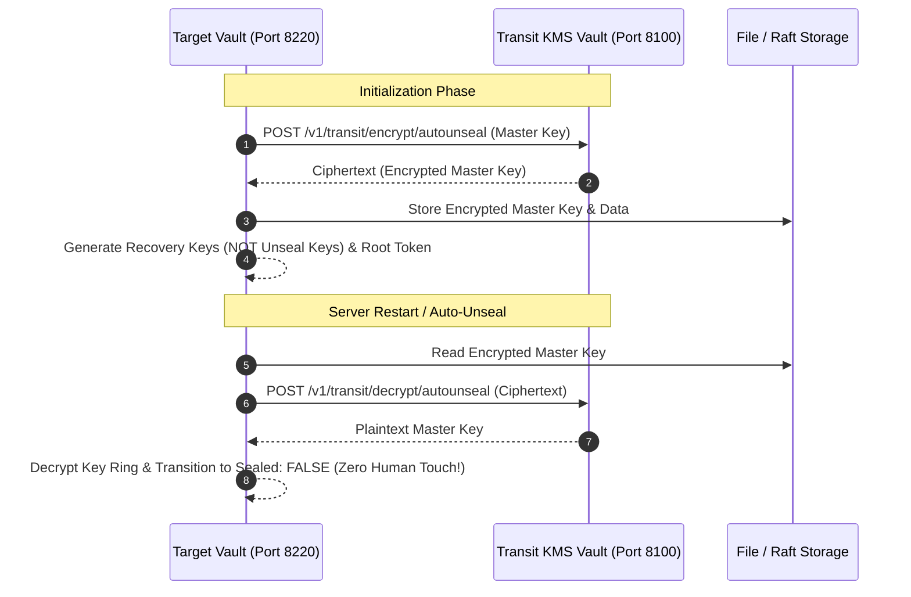

# HashiCorp Vault Transit Auto-Unseal Lab

## 1. Overview & Architecture

By default, HashiCorp Vault requires **Shamir's Secret Sharing** unseal keys to manually unseal whenever a server boots or restarts. In production cloud environments, teams typically use AWS KMS, GCP Cloud KMS, or Azure Key Vault. 

In private data centers, hybrid setups, or air-gapped infrastructure, Vault provides the **Transit Auto-Unseal** feature:
A secondary or central Vault instance (running the **Transit Secrets Engine**) acts as an internal **Cryptography-as-a-Service (KMS)** to automatically encrypt and decrypt the Target Vault's master key.



---

## 2. Port and Service Allocation

| Service | Container Name | Host Port | Internal Port | Purpose |
|---|---|---|---|---|
| **Transit Vault** | `transit-vault-server` | `8100` | `8200` | Acts as the KMS. Exposes `transit/` secrets engine. |
| **Transit Init** | `transit-vault-provisioner` | N/A | N/A | Configures key `autounseal`, policy, and token. |
| **Main Vault** | `main-vault-server` | `8220` | `8200` | Configured with `seal "transit"`. Auto-unseals on boot. |

---

## 3. Key Differences: Shamir Unseal vs Transit Auto-Unseal

| Aspect | Shamir Manual Unseal | Transit Auto-Unseal |
|---|---|---|
| **Keys on `vault operator init`** | **Unseal Keys** (e.g., 3 of 5 required) | **Recovery Keys** (used only for recovery/rekey, NOT unsealing) |
| **Reboot Behavior** | Server boots up **SEALED**; requires human intervention | Server boots up **AUTO-UNSEALED** via Transit KMS |
| **Operational Effort** | High during reboots / maintenance | Zero downtime / fully automated |
| **KMS Dependency** | None | Network connectivity to Transit Vault |

---

## 4. How to Run

### Option A: One-click Setup (PowerShell)
```powershell
cd vault-transit-unseal
.\setup.ps1
```

### Option B: Manual Steps
1. **Start the containers:**
   ```bash
   docker compose up -d
   ```
2. **Run the auto-unseal demonstration test:**
   ```bash
   python test_autounseal.py
   ```

### Option C: Manual CLI Inspection
```bash
# Check Target Vault status (Notice: sealed: false, type: transit)
curl http://127.0.0.1:8220/v1/sys/seal-status

# Restart the container
docker restart main-vault-server

# Check status again - immediately unsealed!
curl http://127.0.0.1:8220/v1/sys/seal-status
```
